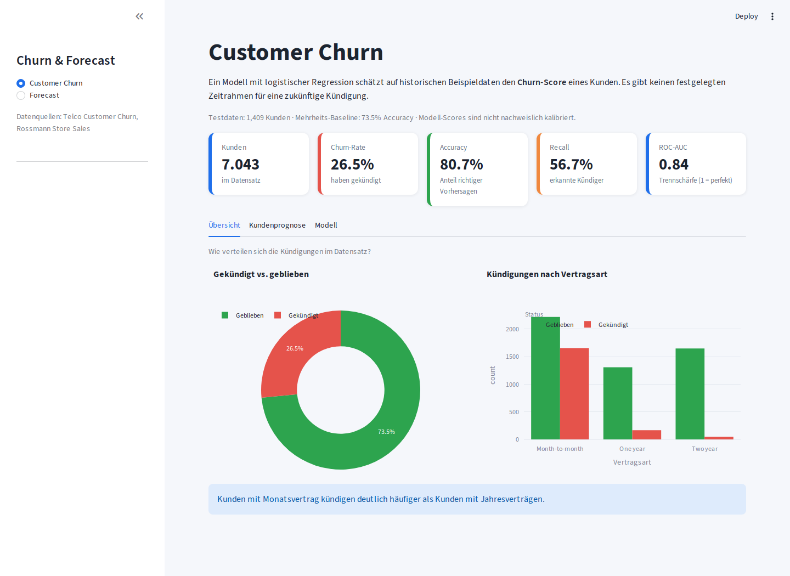
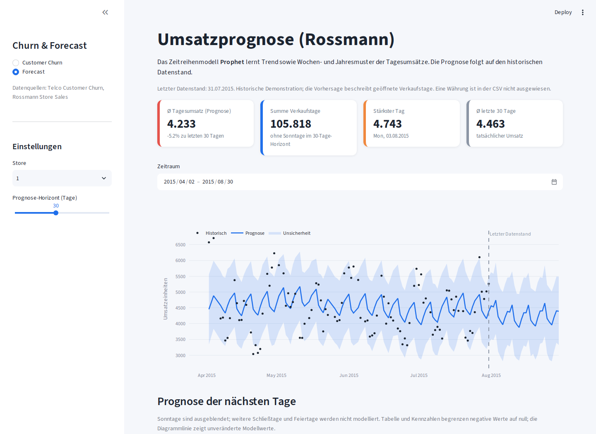

# Customer Churn & Sales Forecast

**Python-Anwendung mit interaktivem Dashboard:** Kündigungsmuster von Telekommunikationskunden analysieren und historische Tagesumsätze von drei Rossmann-Filialen prognostizieren.

[](https://github.com/NabinAd/Mein-Data-Science-Projekt/actions/workflows/quality.yml)

Das Lernprojekt verbindet Datenaufbereitung, Machine Learning und eine bedienbare Oberfläche. Es demonstriert zwei Fragestellungen: Welche Kundenmerkmale hängen mit Kündigungen zusammen? Welche Umsatzmuster lassen sich aus vergangenen Verkaufstagen ableiten? Ein betrieblicher Einsatz oder finanzieller Nutzen wurde nicht nachgewiesen.

## Einblick in die Anwendung





## Funktionen

- **Customer Churn:** Übersicht über 7.043 Kunden, Auswahl einzelner Testkunden, Modell-Scores, Confusion Matrix und Koeffizienten.
- **Modellvergleich:** Logistische Regression und Random Forest im Notebook; einheitliche Vorverarbeitung und derselbe stratifizierte 80/20-Split.
- **Umsatzprognose:** Prophet für Filialen 1–3 mit 7 bis 60 Kalendertagen Prognosehorizont im Dashboard.
- **CSV-Export:** Testkunden mit Scores sowie Umsatzprognosen; Semikolon und Dezimalkomma für deutsches Excel.
- **Qualität:** Eingabevalidierung, pytest-Tests, Streamlit-AppTests, Ruff und GitHub Actions.

## Tech-Stack

| Bereich | Technologien und Konzepte |
|---|---|
| Sprache und Daten | Python 3.12, pandas, NumPy, CSV-Validierung |
| Klassifikation | scikit-learn, Pipeline, ColumnTransformer, Imputation, One-Hot-Encoding, StandardScaler, logistische Regression, Random Forest |
| Zeitreihen | Prophet, zeitlicher Holdout, Vergleich mit Wochen-Baseline |
| Oberfläche und Grafiken | Streamlit, Plotly, Matplotlib, Seaborn |
| Entwicklung | Git, pytest, Ruff, GitHub Actions, Jupyter |

## Lokal starten

Voraussetzung: **Python 3.12**. Die Befehle im Projektordner ausführen.

```powershell
git clone https://github.com/NabinAd/Mein-Data-Science-Projekt.git
cd Mein-Data-Science-Projekt
py -3.12 -m venv .venv
.venv\Scripts\python.exe -m pip install -r requirements.txt
.venv\Scripts\python.exe -m streamlit run app.py
```

Wenn du das Repository bereits lokal hast, beginne mit dem Erstellen der Umgebung. Anschließend die angezeigte Adresse öffnen, normalerweise `http://localhost:8501`.

macOS/Linux:

```bash
python3.12 -m venv .venv
.venv/bin/python -m pip install -r requirements.txt
.venv/bin/python -m streamlit run app.py
```

Die erste Berechnung trainiert die Modelle. Streamlit speichert Ergebnisse zwischen, damit Interaktionen nicht jedes Mal dasselbe Training auslösen. Nach Änderungen an CSV-Dateien den Streamlit-Cache leeren oder die Anwendung neu starten.

### In zwei Minuten ausprobieren

1. Auf **Customer Churn** Accuracy, Recall und die Mehrheits-Baseline vergleichen.
2. Im Tab **Kundenprognose** einen Testkunden auswählen; Modell-Score und tatsächlich beobachtete Kündigung gegenüberstellen.
3. Im Tab **Modell** Confusion Matrix und positive/negative Koeffizienten ansehen.
4. In der Seitenleiste **Forecast**, Filiale und Horizont auswählen; Zeitraum ändern und Prognose als CSV herunterladen.

Es gibt derzeit keine veröffentlichte Live-Demo.

## Ergebnisse und Einordnung

Neuberechnung der Churn-Pipeline am **26.10.2026**, Python 3.12 auf Linux, Testset mit **1.409 Kunden**:

| Kennzahl | Logistische Regression |
|---|---:|
| Accuracy | 80,70 % |
| Precision | 65,84 % |
| Recall | 56,68 % |
| F1-Score | 60,92 % |
| ROC-AUC | 0,8416 |
| Accuracy der Mehrheits-Baseline | 73,46 % |

Die höhere Accuracy allein genügt nicht: Das Modell erkennt nur rund 57 % der tatsächlichen Kündiger. Die Vorverarbeitung wird ausschließlich auf Trainingsdaten gelernt. Die Scores sind nicht nachweislich kalibriert; die Daten definieren keinen konkreten Zeitraum bis zu einer zukünftigen Kündigung.

Das [Forecast-Notebook](notebooks/04_sales_forecasting.ipynb) hält die letzten 30 Kalendertage von Filiale 1 zurück und vergleicht Prophet mit einer einfachen Wochen-Baseline. `MAE / mittlerer Ist-Umsatz` wird ausdrücklich als normalisierter MAE ausgewiesen, nicht als MAPE. Der geprüfte Lauf ergibt **615,69 Umsatzeinheiten MAE** für Prophet gegenüber **967,81** für die Wochen-Baseline, bewertet auf 26 Verkaufstagen. Das ist ein einzelnes Testfenster, kein allgemeiner Leistungsnachweis.

## Aufbau

```text
app.py                         Streamlit-Oberfläche, Navigation und Caching
src/churn.py                   CSV-Prüfung, Churn-Pipeline und Testkennzahlen
src/forecasting.py             CSV-Prüfung, Filialdaten und Prophet-Prognose
notebooks/                     Vier Analysen in nachvollziehbarer Reihenfolge
tests/                         Daten-, Pipeline-, Forecast- und Oberflächentests
scripts/run_notebooks.py       Notebook-Zellen in separaten Prozessen ausführen
data/telco/                    Telco-Datensatz
data/rossmann/                 Rossmann-Originaldaten, Teilmenge und Prognoseexport
docs/images/                   Echte Dashboard-Screenshots und Ergebnisgrafiken
.github/workflows/quality.yml  Automatische Prüfungen
```

## Tests und Entwicklung

```powershell
.venv\Scripts\python.exe -m pip install -r requirements-dev.txt
.venv\Scripts\python.exe -m pytest -q
.venv\Scripts\python.exe -m ruff check .
.venv\Scripts\python.exe -m ruff format --check .
```

Formatierung anwenden: `.venv\Scripts\python.exe -m ruff format .`.

Unter macOS/Linux entsprechend `.venv/bin/python` verwenden. GitHub Actions führt Tests, Linter, Formatprüfung und alle vier Notebook-Abläufe aus. Die Oberflächentests bedienen beide Seiten, Kundenauswahl, Filiale und Prognosehorizont.

### Notebooks nachvollziehen

```powershell
.venv\Scripts\python.exe -m notebook
```

1. [01_prepare_data.ipynb](notebooks/01_prepare_data.ipynb): Originaldaten auf Filialen 1–3 reduzieren; optional, die Teilmenge ist enthalten.
2. [02_exploratory_analysis.ipynb](notebooks/02_exploratory_analysis.ipynb): Datentypen, fehlende Werte, Kündigungen und Umsatzverteilung.
3. [03_churn_prediction.ipynb](notebooks/03_churn_prediction.ipynb): Klassifikation, Kennzahlen und Random-Forest-Vergleich.
4. [04_sales_forecasting.ipynb](notebooks/04_sales_forecasting.ipynb): Prophet, zeitlicher Test, Wochen-Baseline und Export.

Kernel neu starten und Zellen von oben nach unten ausführen. Alternativ prüft `python scripts/run_notebooks.py` die Codezellen ohne Jupyter-Server in einem frischen Python-Prozess pro Notebook. Mit `--write` werden auch Notebook-Ausgaben gespeichert. Die Notebooks schreiben ihre dokumentierten CSV-Dateien und Grafiken neu; Prophet-Unsicherheitsintervalle können zwischen Läufen variieren.

## Daten und Quellen

| Datei | Umfang und Verwendung |
|---|---|
| `data/telco/WA_Fn-UseC_-Telco-Customer-Churn.csv` | 7.043 Kunden, 21 Spalten; 1.869 Kündigungen |
| `data/rossmann/train.csv` | 1.017.209 Originalzeilen; optional für die Vorbereitung |
| `data/rossmann/train_filtered.csv` | 2.826 Zeilen für Filialen 1–3, 01.01.2013–31.07.2015 |
| `data/rossmann/forecasts.csv` | Beispiel-Export mit historischen Modellwerten und Zukunftsprognosen; wird vom Dashboard nicht eingelesen |

Die Datensätze sind im Repository enthalten. Quellen: [Telco Customer Churn](https://www.kaggle.com/datasets/blastchar/telco-customer-churn) und [Rossmann Store Sales](https://www.kaggle.com/competitions/rossmann-store-sales/data). Die Nutzungsbedingungen der jeweiligen Quellen gelten unabhängig vom Projektcode.

## Grenzen und nächste Schritte

- Historische Demonstration: Die Rossmann-Prognose beginnt nach dem Datenende **31.07.2015**, nicht nach dem heutigen Datum. Die CSV weist keine Währung aus.
- Prophet lernt nur aus geöffneten Tagen mit positivem Umsatz. Sonntage werden in Zukunftstabelle und Kennzahlen ausgeblendet; weitere Schließtage, Feiertage und Aktionen werden noch nicht modelliert. Die Summe ist keine vollständige Kalender-Umsatzplanung.
- Churn: ein einzelner Testsplit, keine Kreuzvalidierung oder Wahrscheinlichkeitskalibrierung. Koeffizienten zeigen Modellzusammenhänge, keine Kausalität.
- Forecast: zeitlicher Test bisher nur für eine Filiale und ein Fenster; weitere Backtests stehen aus.
- Direkte Abhängigkeiten sind festgelegt; ein vollständiger Lock aller indirekten Pakete fehlt. Geprüft wurde Python 3.12.14 auf Linux; Windows/macOS wurden hier nicht ausgeführt.

Die nächsten Schritte stehen in [ROADMAP.md](ROADMAP.md). Für den Projektcode ist derzeit keine ausdrückliche Open-Source-Lizenz festgelegt.

## Lernziele

Daten prüfen und bereinigen, Training und Test sauber trennen, Modelle mit einfachen Baselines vergleichen, Ergebnisse verständlich darstellen und die Anwendung mit Tests und Versionsverwaltung weiterentwickeln.
